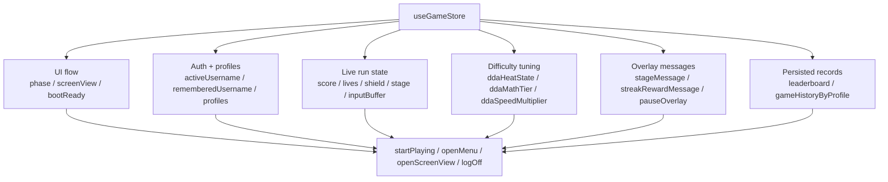

# Application store

## Store architecture

The game state is centralized in `src/store/useGameStore.ts` using Zustand. The store owns the UI flow, profile/session state, active run stats, DDA tuning, overlays, and persisted history data.

### Store module layout

- `src/store/useGameStore.ts` wires Zustand + persist middleware and composes actions.
- `src/store/setters/` contains action-setter factories that orchestrate `set/get` updates.
- `src/store/transformers/` contains pure state transformers used by setters.
- `src/store/utilities/` contains reusable store-level helpers and migrations.

All new functions in `setters` and `transformers` should include complete JSDoc (`@param`, `@returns`, `@example`, and `@throws` when relevant) to improve AI assistant context and maintainability.

### Store structure diagram

### Main state items

| Key | Type | Description |
| --- | --- | --- |
| `phase` | `OverlayPhase` | Current overlay lifecycle: booting, login, start, playing, paused, stage-message, gameover. |
| `screenView` | `ScreenView` | Active React screen: home, practice-select (practice operation picker shown before a practice run), profile, settings, performance, rules, weekly-report, or achievements. |
| `bootReady` | `boolean` | Set once the boot sequence finishes and the app can render the main menu flow. |
| `activeUsername` | `string \| null` | Logged-in profile currently active for the session. |
| `rememberedUsername` | `string \| null` | Persisted username used to restore a session after reload. |
| `profiles` | `Record<string, PlayerProfile>` | Registered player profiles, including avatar, best score, highest reached stage, and timestamps. |
| `grade` | `Grade` | Current player grade, used for progression filtering. |
| `score` | `number` | Current in-run score. |
| `lives` | `number` | Remaining player lives. |
| `shield` | `number` | Shield strength for the base. |
| `stage` | `number` | Active stage number. |
| `stageScore` | `number` | Score accumulated during the current stage. |
| `inputBuffer` | `string` | Current typed answer buffer. |
| `correctCount` | `number` | Number of correct answers in the running session. |
| `incorrectCount` | `number` | Number of incorrect answers in the running session. |
| `streak` | `number` | Current answer streak. |
| `finalPerfScore` | `number` | Performance score used at game-over submission. |
| `ddaHeatState` | `DDAHeatState` | Dynamic difficulty state such as balanced, hot, or cooloff-related values. |
| `ddaMathTier` | `DDAMathTier` | Current math complexity tier in the DDA system. |
| `ddaSpeedMultiplier` | `number` | Current meteor speed multiplier derived from performance. |
| `ddaIsCooloffActive` | `boolean` | Whether the game is currently in a cooler recovery phase. |
| `stageMessage` | `StageMessageState \| null` | Stage transition message and summary metrics. |
| `streakRewardMessage` | `StreakRewardMessageState \| null` | Reward text shown after successful streak milestones. |
| `pauseOverlay` | `PauseOverlayState \| null` | Pause state triggered by escape/break or window close handling. |
| `gradeNotice` | `GradeNotice \| null` | After-run promotion or demotion message. Transient. |
| `achievementNotice` | `EarnedAchievement[] \| null` | Awards earned by the last saved run. Shown after `gradeNotice` is dismissed. Transient. |
| `gameHistoryByProfile` | `Record<string, GameHistoryEntry[]>` | Per-profile session history used for lifetime grade and profile analytics. |

### Store actions and helper methods

| Action | Purpose |
| --- | --- |
| `markBootReady` | Restores a remembered profile or falls back to the login screen after startup. |
| `setGrade` | Updates the current grade without altering the rest of the run state. |
| `syncHUD` | Updates transient HUD values efficiently without writing to profile data. |
| `showStageMessage` | Triggers a stage summary overlay. |
| `showStreakRewardMessage` | Displays the streak bonus message. |
| `clearStreakRewardMessage` | Clears the active streak reward overlay. |
| `showPauseOverlay` | Shows a pause overlay for one of the supported reasons. |
| `hidePauseOverlay` | Restores the previous phase after unpausing. |
| `showSavingBeforeClose` | Shows a save-before-close state for shutdown flows. |
| `showGameOver` | Finalizes a run, updates best/highest profile metrics, and transitions to gameover. |
| `persistPrematureGameEnd` | Saves partial game history when the game exits unexpectedly. Checks awards like `addGameHistory`. |
| `dismissAchievementNotice` | Clears the after-run achievement notice. |
| `startPlaying` | Begins active gameplay and clears overlay state. |
| `openMenu` | Returns to the menu while preserving session data. |
| `openScreenView` | Opens a specific screen while keeping the game session intact. |
| `logOff` | Logs the current user out and returns to login. |
| `selectProfileByUsername` | Logs in an existing profile by username, optionally remembering it. |
| `createAndLoginSimpleProfile` | Creates a new profile from a username, then logs it in. |
| `updateActiveProfileAvatar` | Updates the active profile avatar selection from the supported avatar catalog. |
| `getActiveProfile` | Resolves the profile object for the current user. |
| `addGameHistory` | Appends a new gameplay record for the active profile or guest bucket, then checks for new awards. |
| `getGameHistory` | Retrieves recent game history for a profile or the active player. |

### Persistence rules

The Zustand persist middleware stores only the durable data needed across sessions:

- `profiles`
- `gameHistoryByProfile`
- `rememberedUsername`

The live run state such as score, stage, lives, shield, input buffer, and overlay messages is intentionally not persisted. This keeps reloads predictable while preserving profile history continuity.

Profile persistence uses a normalized migration step. Persisted profile payloads are converted into the canonical `PlayerProfile` shape, malformed profile entries are dropped, and only the canonical keys are written back.

### Achievements contract

Awards live in `src/store/selectors/achievements.ts` (pure, `now` passed in) and are saved on the profile as `PlayerProfile.achievements: EarnedAchievement[]`.

- **Week and day keys** use local time: `toDayKey` gives `YYYY-MM-DD`, `toWeekKey` gives the ISO week (`2026-W46`, Monday start). Keys are built from local date parts, never by dividing by `DAY_MS`, so DST changes are safe.
- **Active day:** a local day whose runs total at least `ACTIVE_DAY_MIN_CORRECT` correct answers. **Streak week:** at least `STREAK_MIN_DAYS_PER_WEEK` active days. `computeWeeklyStreak` walks the weeks from the oldest run; the current week adds to the streak once it qualifies and never breaks it.
- **Saved when earned:** `evaluateNewAchievements(history, profile, now, { isAfterRun })` returns only awards the profile has not saved. Weekly awards are unique per `id + weekKey`; one-time awards (Relentless tiers, mastery) per `id`. Saved awards are never removed, even if rules or goals change.
- **When awards are checked:**
  - after every saved run (`addGameHistory`, `persistPrematureGameEnd`): new awards are appended to the profile and to `achievementNotice`;
  - silently when a profile becomes active (`selectProfileByUsername`, `createAndLoginSimpleProfile`, and restoring a remembered profile in `markBootReady`): history is backfilled with no notice, and awards that must not be backfilled are skipped (`isAfterRun: false`).
- **Guests** see progress worked out live, but nothing is saved and no notice is shown.
- **New badges** add an evaluator to `ACHIEVEMENT_EVALUATORS`; the login check then backfills them automatically.
- **Persistence:** persist version 7. `migrateProfiles` sets `achievements` to a validated list (`[]` when missing), drops unknown ids or malformed entries, and drops the legacy `password` field.

### Additional info useful to AI assistants

- Keep gameplay logic in `src/game/main.ts` and Phaser rendering in `src/game/scenes/GameScene.ts`; avoid duplicating run-state behavior in the store.
- Treat Zustand as the integration boundary between React UI and Phaser gameplay state.
- When adding new persisted state, update both the `initialState` object and the `partialize` block in `useGameStore.ts` so the storage contract stays consistent.
- Use `syncHUD` for ephemeral UI updates that should not mutate persistent profile data or localStorage.
- `resolveLifetimeGrade` and `resolveActiveProfile` are the go-to helpers when profile-based grade or session state needs to be derived.
- Prefer editing the owning layer instead of scattering logic across overlay, Phaser, and React components.
- The `gameHistoryByProfile` data is profile-scoped, with guest sessions falling back to `__guest__`.

### Suggested AI assistant prompts

- "Show how the store transitions from login to playing and then to gameover."
- "Where should I add a new gameplay stat so it stays in sync with the Phaser scene and React HUD?"
- "Explain which store fields are persisted and which are ephemeral."
- "Help trace a profile-grade update from `addGameHistory` through `resolveLifetimeGrade` to `showGameOver`."
- "Review the store for any state that should be added to `initialState` if I add a new gameplay mechanic."
